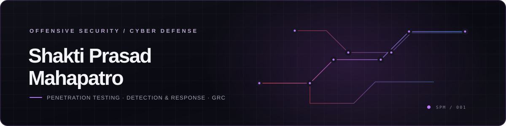

<h1 align="center">Shakti Prasad Mahapatro</h1>

<strong>Penetration Tester · Offensive Security · Detection &amp; Response · GRC</strong>

<a href="https://shaktiprasadm.netlify.app">Portfolio</a> · <a href="Shakti_Prasad_Mahapatro_CV.pdf">Download CV</a> · <a href="mailto:shaktiprasad24675@gmail.com">Email</a>

I test systems from an attacker’s perspective, then help teams improve how they detect, respond, and reduce risk. My experience spans web and API VAPT, Active Directory, cloud security, SOC support, incident response, compliance advisory, and security training.

**Based in:** Bhubaneswar, Odisha, India · **Current role:** Security Engineer — Penetration Testing at Aexantis Technologies · **Credential:** CEH, EC-Council

## At a glance

| 18+ | 20+ | 600+ | 97% |
|:---:|:---:|:---:|:---:|
| Security projects delivered | Critical vulnerabilities discovered | Students trained | Client retention across engagements |

## How I work

- **Red team:** Web, API, network, mobile, and Active Directory security testing; OSINT and adversary simulation; findings backed by evidence and scoped to authorized engagements.
- **Blue team:** SIEM monitoring, incident triage, phishing defense, threat detection, cloud posture, and practical remediation.
- **Purple team:** Connect attack paths to detection and controls, then translate technical findings into prioritized actions.

## Selected work

- **Web application VAPT:** Black-box and grey-box testing across a multi-tenant SaaS platform, covering authentication, authorization, and OWASP risks. Delivered proof-of-concept evidence and CVSS-scored remediation guidance.
- **Active Directory attack paths:** Simulated identity weaknesses in a controlled lab and documented attack-path visibility and hardening guidance.
- **Cloud and IAM audit:** Reviewed AWS/Azure permissions, storage exposure, logging, and policy weaknesses; delivered a prioritized remediation roadmap.
- **SOC monitoring and incident triage:** Analyzed 5,000+ daily events at TCS and triaged 100+ incidents in a BFSI environment.
- **Email security:** Implemented and validated SPF, DKIM, and DMARC after phishing simulations; reported phishing incidents reduced by 60% in that environment.
- **Security controls and automation:** Built GRC foundations and designed AI-assisted detection pipelines and security automation for managed SOC engagements.

Client environments and sensitive details are generalized. The complete portfolio site is published from `site/` in this repository.

## Experience

| Role | Organization | Dates |
|---|---|---|
| Security Engineer — Penetration Testing | Aexantis Technologies Pvt. Ltd. | Jan 2026–Present |
| Senior Executive — Cybersecurity & IT Compliance | Anmol Industries Limited | Jul–Nov 2025 |
| IT Specialist — Cybersecurity (SOC Support) | SBI General Insurance | Dec 2024–Jul 2025 |
| Cybersecurity Trainer | IBM ICT Initiative, via Secuneus Tech | Freelance |
| Cybersecurity Analyst Intern | Tata Consultancy Services (TCS) | Dec 2023–Jun 2024 |

## Toolkit

**Testing:** Burp Suite, Metasploit, Nmap, SQLMap, OWASP ZAP, Nikto, Gobuster, Hydra  
**Detection:** Splunk, Wazuh, Microsoft Sentinel, QRadar, Sigma, KQL, Nessus, OpenVAS  
**Identity & cloud:** BloodHound, Impacket, CrackMapExec, AWS, Azure, IAM, CSPM, MobSF, Frida  
**Methods:** PTES, MITRE ATT&CK, OWASP Top 10, OWASP API Top 10, CVSS, Kill Chain

## Certifications

- CEH — Certified Ethical Hacker, EC-Council
- GCIA — GIAC Certified Intrusion Analyst
- ISO/IEC 27001 Information Security Associate
- Google Cybersecurity Professional Certificate
- Google Gemini AI Certified
- OCI Generative AI Professional, Oracle
- TryHackMe Junior Penetration Tester path
- Diploma in Cybersecurity, Alison

## Education

- **MBA, IT & Finance** — Manipal University, Cybersecurity & Security Infrastructure specialization · 2025–Present
- **B.Sc. Computer Science** — Berhampur University · 2020–2024

## Contact

- **Email:** [shaktiprasad24675@gmail.com](mailto:shaktiprasad24675@gmail.com)
- **Phone:** [+91 76090 31589](tel:+917609031589)
- **Portfolio:** [shaktiprasadm.netlify.app](https://shaktiprasadm.netlify.app)
- **Location:** Bhubaneswar, Odisha, India

---

Offense informs defense. Evidence drives progress.

