<!-- Shakti Prasad Mahapatro · GitHub profile README -->
<!-- Put this file at the root of your profile repo (shaktiprasadm/shaktiprasadm) and keep the ./assets folder beside it. -->







### `// 01 · SELECTED OPERATIONS`





**📍 Bhubaneswar, Odisha, India** · **✉️ shaktiprasad24675@gmail.com** · **🌐 [shaktiprasadm.netlify.app](https://shaktiprasadm.netlify.app)**

