<!-- Shakti Prasad Mahapatro · GitHub profile README
     Place at the root of your profile repo (<username>/<username>) with ./assets beside it. -->

 

## 🎯 Selected Operations

## 🕹️ BREACH.EXE

*Not a real game, just how I think about it: every threat that falls is one I already know how to stop.*

